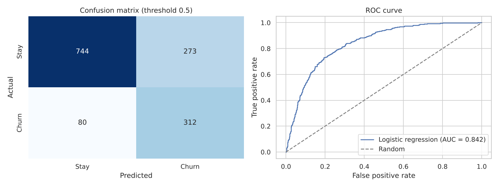
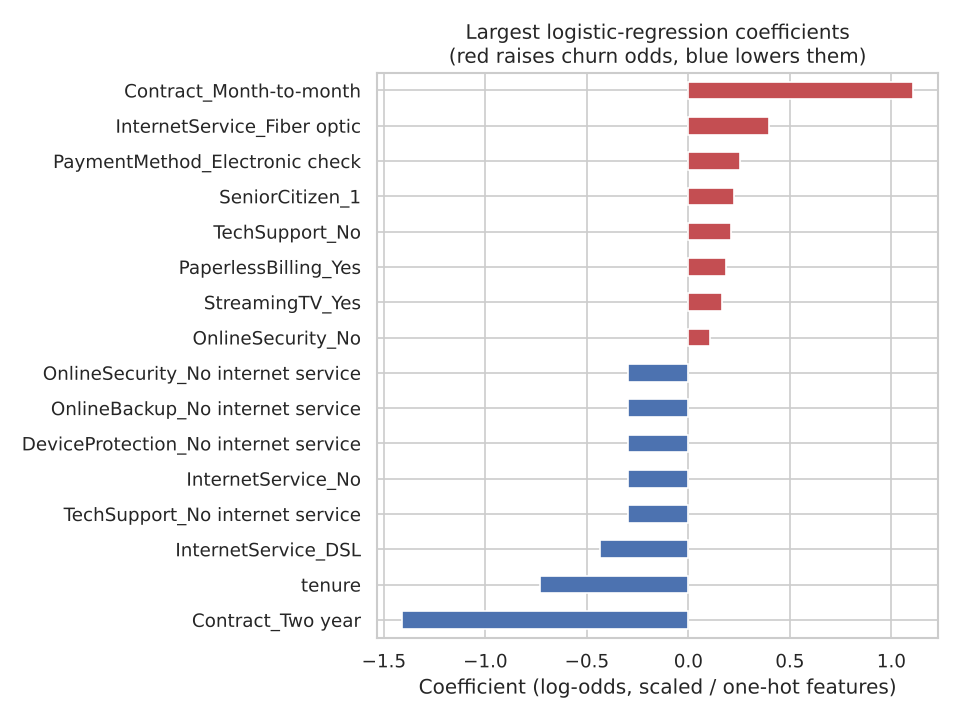
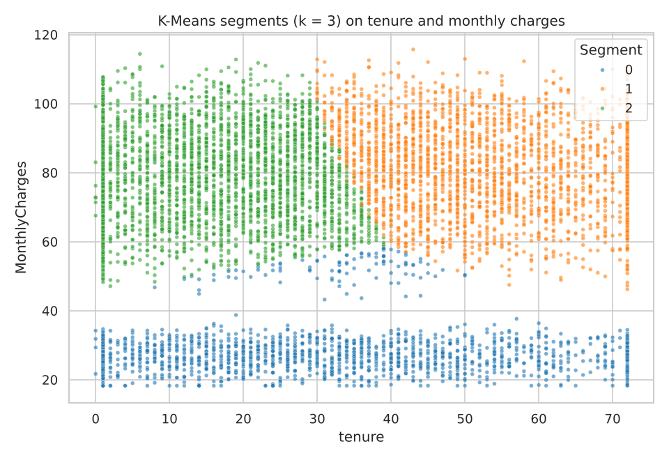

# Customer Churn: Classification, Risk Scoring and Segmentation

[](https://github.com/mohammedelsayed741996-blip/telco-customer-churn-ml/actions/workflows/tests.yml)
[](https://colab.research.google.com/github/mohammedelsayed741996-blip/telco-customer-churn-ml/blob/main/notebooks/customer_churn_analysis.ipynb)
 

Which telecom customers are likely to leave, and what do the groups at risk look like? This project answers both questions with three complementary models: a **logistic regression classifier**, a **calibrated churn-probability score** for ranking customers, and **K-Means segmentation**.

> **Data note.** The dataset is **simulated** (`src/generate_data.py`, fixed seed): 7,043 customers with the same 21 columns as the public IBM Telco Customer Churn sample. Churn is drawn from a known logistic model, so the analysis can be checked against the truth that generated it.

## Results

| Metric | Value |
|---|---|
| Customers / churn rate | 7,043 / 27.8% |
| Logistic regression, test ROC-AUC | **0.842** (5-fold CV on train: 0.838 ± 0.011) |
| Churn recall / precision (threshold 0.5, balanced class weights) | 79.6% / 53.3% |
| Brier score of the churn probabilities | 0.141 (base-rate reference 0.201, skill 0.30) |
| Churn rate in the top-risk decile | **70.9%**, 2.55× the average |
| Highest-risk segment (short tenure, high monthly charges) | 49.0% churn, 3,056 customers |

**What drives churn.** The model recovers the drivers built into the data: month-to-month contracts, fibre internet, electronic-check payment and missing tech support raise churn odds; two-year contracts and longer tenure lower them. Churn by contract: month-to-month 44.2%, one year 14.1%, two year 2.5%.





## Approach

1. **Data quality.** `TotalCharges` is stored as text and is blank for 11 customers with tenure 0. Those are set to 0 (no bill yet) rather than filled with the mean.
2. **Classifier.** One scikit-learn `Pipeline` (scaling + one-hot encoding + logistic regression), so the test set never leaks into preprocessing. Stratified 80/20 split plus 5-fold cross-validation. Compared with a majority-class baseline (72.2% accuracy).
3. **Probability scoring.** An unweighted logistic regression keeps probabilities calibrated. It is checked with the Brier score, a calibration curve and a decile lift table: the format a retention team actually uses.
4. **Segmentation.** K-Means on scaled tenure and charges; k chosen by the best silhouette score (k = 3). Churn is not an input. It is only used to profile the segments afterwards.

## Repository structure

```
├── data/telco_customer_churn.csv          simulated dataset (see data/README.md)
├── notebooks/customer_churn_analysis.ipynb  full analysis with outputs
├── reports/figures/                         charts used above
├── reports/results_summary.csv              headline metrics written by the notebook
├── src/generate_data.py                     reproducible data generator
└── tests/                                   pytest checks for the data and the model
```

## Run it

```bash
pip install -r requirements.txt
python src/generate_data.py        # optional: rebuilds data/ (same seed, same file)
pytest -q
jupyter notebook notebooks/customer_churn_analysis.ipynb
```

Or click **Open in Colab**: the notebook reads the data straight from this repository.

## Tech stack

Python · pandas · NumPy · scikit-learn (Pipeline, ColumnTransformer, LogisticRegression, KMeans) · matplotlib · seaborn · pytest · GitHub Actions

---
Mohamed Abdelrasoul · [LinkedIn](https://www.linkedin.com/in/mohamed-abdelrasoul-b07002173) · [GitHub](https://github.com/mohammedelsayed741996-blip)
